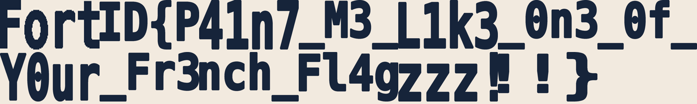

<a id="en"></a>
# 06 — Paint me a Flag
**🇬🇧 English** · [🇷🇺 Русский](#ru)

| | |
|---|---|
| **Category** | 🔧 Reverse |
| **Challenge files** | `paint_me_a_flag` (ELF x86-64, stripped, libpng), `flag_part_01..13.{png,pmaf}` |
| **Status** | ✅ Solved |
| **Flag** | `FortID{P41n7_M3_L1k3_0n3_0f_Y0ur_Fr3nch_Fl4gzzz!!!}` |

## 1. Description

`paint_me_a_flag <start.png> <part.pmaf> <out.png>` "paints" one piece of the
flag: it starts from a noisy canvas (`flag_part_NN.png`) and replays the
encrypted instructions from `flag_part_NN.pmaf`. There are 13 parts. When I ran
the first one (256 × 96) it finished instantly and showed `Fort`; parts 02–13
(1600 × 600) are deliberately so slow that a single part runs for **hours**.

## 2. Initial analysis

```bash
file paint_me_a_flag          # ELF 64-bit x86-64, PIE, stripped, links libpng
xxd -l 40 flag_part_02.pmaf   # "PMAF\3\r\n\x1a" + header
```

From the header parser (`0x37a0`) I reconstructed the `.pmaf` layout
(little-endian):

| offset | type | field |
|---|---|---|
| 0 | 8 B | magic `PMAF\x03\r\n\x1a` |
| 8 | u32 | width `W` |
| 12 | u32 | height `H` |
| 16 | u64 | number of ops `NP` (= `W·H`) |
| 24 | u64 | `seed` |
| 32 | u32 | `diff` (0 for part 01, 64 for parts 02–13) |
| 36 | u32 | must be 0 |
| 40 | `NP` × u64 | encrypted ops |

The magic constants `0xbf58476d1ce4e5b9` and `0x94d049bb133111eb` told me
straight away that all hashing is the **splitmix64 finaliser** `mix(z)`.

## 3. Investigation path

**What I confirmed — the renderer (from `main` and the fill routine `0x3370`)**

1. **Initial state.** In `main`, right before the op loop, I found how the
   state is seeded:
   ```
   S0 = mix( mix(NP) ^ seed ^ H ^ (W << 32) ^ diff·0xd6e8feb86659fd93 ^ 0x6f3d9b21a4c875e1 )
   ```
2. **Decoding op `n`** (`ctr = n · 0x9e3779b97f4a7c15`):
   ```
   V   = mix(ctr ^ state) ^ op[n]
   X   = V & 0xFFFFFF            # target pixel index
   Y   = (V >> 24) & 0xFFFFFF    # new colour (RGB)
   tag = V >> 48                 # must equal mix((Y<<24 | X) ^ ctr ^ state) >> 48
   ```
3. **Flood fill.** The 4-connected region of equal colour that contains `X` is
   repainted with `Y`. The fill returns `f1` = pixels changed,
   `f2` = XOR of `mix(p ^ 0x243f6a8885a308d3)` over those pixels, and
   `f3` = the old colour.
4. **State update.** `state = F(state, ctr, Y, f1, f2, f3)` — a fixed mix-based
   formula. So the next op can't be decrypted without the exact result of this
   fill; there is no way to skip ahead.
5. **Decoy rounds** (`diff` = 64 times per op): pick a pseudo-random colour,
   repaint the whole region that now contains `X`, then paint it back with `Y`.
   The canvas ends up unchanged — only the state absorbs the region's size and
   hash.

**Why it was slow**

- Every fill is a BFS over a region. Towards the end of the image the regions
  cover a large part of the 960 000-pixel canvas, and every op triggers
  1 + 2 · 64 fills — on the order of 10⁸ fills of growing regions per part.

**The idea that solved it — track regions, not pixels**

- I noticed that everything the state consumes is a **per-region** value:
  size, XOR-hash and colour. So I kept the regions in a **union-find**:
  - an op recolours one root (`f1 = size`, `f2 = hash`) and merges it with each
    neighbouring region that already has colour `Y`;
  - sizes and hashes merge in O(1) (`size_a + size_b`, `hash_a ^ hash_b`);
  - the decoy rounds only need the merged region's size and hash, so I computed
    them arithmetically without touching the canvas at all.
- The 16-bit tag of every op gave me a free correctness check: if any formula
  or `S0` had been wrong, the tags would have stopped matching on the first ops.

## 4. Tools & commands

```bash
objdump -d -M intel paint_me_a_flag > dis.txt   # reverse main / fill / update
cc -O2 -o render render.c                       # fast bit-exact renderer
pip install pillow numpy loguru
python3 solve.py handout/ out/                  # all 13 parts + flag sheet
```

See [`render.c`](render.c) and [`solve.py`](solve.py).

## 5. Step-by-step

1. I reversed `main`: argument handling, PNG loading, the `.pmaf` header
   parser (`0x37a0`), the `S0` computation and the op loop.
2. I reversed the fill routine (`0x3370`) and the state update, including the
   decoy loop and its counter `r14 += 0xd6e8feb86659fd93`.
3. I re-implemented the state machine 1:1 with regions in union-find
   ([`render.c`](render.c)) and checked on part 01 that every tag matched.
4. I converted each `flag_part_NN.png` to raw `0x00RRGGBB`, rendered it and
   converted the result back to PNG ([`solve.py`](solve.py)).
5. I put the 13 rendered pieces side by side and read the flag left to right.

## 6. Solution

```
$ python3 solve.py handout/ out/
ops=24576  bad_tags=0
SUCCESS  part 01 rendered -> out_01.png
ops=960000 bad_tags=0
SUCCESS  part 02 rendered -> out_02.png
...
SUCCESS  flag sheet -> out/flag.png
```

`bad_tags=0` showed me the re-implementation is bit-exact with the original
binary. A 1600 × 600 part (960 000 ops × 64 decoy rounds) took **≈ 7 minutes
on one core** instead of hours.



## 7. Flag

```
FortID{P41n7_M3_L1k3_0n3_0f_Y0ur_Fr3nch_Fl4gzzz!!!}
```

## 8. Key takeaways

- **What tipped me off:** a renderer that is "too slow to finish". The intended
  path is to rewrite it faster, not to wait for it.
- **Why it worked:** the state depends only on per-region aggregates (size,
  XOR-hash, colour), which union-find maintains incrementally, so the decoy
  work collapses into plain arithmetic.
- **What doesn't work:** skipping ops — the chained state makes every op depend
  on the exact result of the previous fill.
- **What I'll remember:** chained hash state plus a per-step integrity tag
  means the computation has to be reproduced exactly; I look at what the state
  really consumes and compute only that.

---

<a id="ru"></a>
# 06 — Paint me a Flag
[🇬🇧 English](#en) · **🇷🇺 Русский**

| | |
|---|---|
| **Категория** | 🔧 Reverse |
| **Файлы задания** | `paint_me_a_flag` (ELF x86-64, stripped, libpng), `flag_part_01..13.{png,pmaf}` |
| **Статус** | ✅ Solved |
| **Флаг** | `FortID{P41n7_M3_L1k3_0n3_0f_Y0ur_Fr3nch_Fl4gzzz!!!}` |

## 1. Условие

`paint_me_a_flag <start.png> <part.pmaf> <out.png>` «рисует» кусок флага:
начинает с зашумлённого холста (`flag_part_NN.png`) и воспроизводит
зашифрованные инструкции из `flag_part_NN.pmaf`. Частей 13. Когда я запустил
первую (256 × 96), она досчиталась мгновенно и показала `Fort`; части 02–13
(1600 × 600) специально сделаны настолько медленными, что одна часть идёт
**часами**.

## 2. Первичный анализ

```bash
file paint_me_a_flag          # ELF 64-bit x86-64, PIE, stripped, libpng
xxd -l 40 flag_part_02.pmaf   # "PMAF\3\r\n\x1a" + заголовок
```

По парсеру заголовка (`0x37a0`) я восстановил формат `.pmaf` (little-endian):

| смещение | тип | поле |
|---|---|---|
| 0 | 8 Б | magic `PMAF\x03\r\n\x1a` |
| 8 | u32 | ширина `W` |
| 12 | u32 | высота `H` |
| 16 | u64 | число операций `NP` (= `W·H`) |
| 24 | u64 | `seed` |
| 32 | u32 | `diff` (0 для части 01, 64 для частей 02–13) |
| 36 | u32 | должно быть 0 |
| 40 | `NP` × u64 | зашифрованные операции |

По константам `0xbf58476d1ce4e5b9` и `0x94d049bb133111eb` я сразу понял, что
всё хеширование — это **финализатор splitmix64** `mix(z)`.

## 3. Путь исследования

**Что я подтвердил — рендерер (`main` и функция заливки `0x3370`)**

1. **Начальное состояние.** В `main` прямо перед циклом операций нашёл, как
   инициализируется состояние:
   ```
   S0 = mix( mix(NP) ^ seed ^ H ^ (W << 32) ^ diff·0xd6e8feb86659fd93 ^ 0x6f3d9b21a4c875e1 )
   ```
2. **Расшифровка операции `n`** (`ctr = n · 0x9e3779b97f4a7c15`):
   ```
   V   = mix(ctr ^ state) ^ op[n]
   X   = V & 0xFFFFFF            # индекс целевого пикселя
   Y   = (V >> 24) & 0xFFFFFF    # новый цвет (RGB)
   tag = V >> 48                 # должен равняться mix((Y<<24 | X) ^ ctr ^ state) >> 48
   ```
3. **Заливка.** 4-связная область одного цвета, содержащая `X`, перекрашивается
   в `Y`. Заливка возвращает `f1` — число изменённых пикселей, `f2` — XOR
   `mix(p ^ 0x243f6a8885a308d3)` по этим пикселям и `f3` — старый цвет.
4. **Обновление состояния.** `state = F(state, ctr, Y, f1, f2, f3)` —
   фиксированная формула на `mix`. Значит, следующую операцию не расшифровать
   без точного результата этой заливки — перескочить вперёд нельзя.
5. **Ложные раунды** (`diff` = 64 раза на операцию): выбирается
   псевдослучайный цвет, им перекрашивается вся область, которая теперь
   содержит `X`, затем ей возвращается цвет `Y`. Холст в итоге не меняется —
   состояние лишь впитывает размер и хеш области.

**Почему было медленно**

- Каждая заливка — это BFS по области. Ближе к концу изображения области
  занимают большую часть холста из 960 000 пикселей, а каждая операция вызывает
  1 + 2 · 64 заливки — порядка 10⁸ заливок растущих областей на одну часть.

**Идея, которая решила задачу — считать области, а не пиксели**

- Я заметил, что всё, что потребляет состояние, — это значения **по областям**:
  размер, XOR-хеш и цвет. Поэтому я хранил области в **union-find**:
  - операция перекрашивает один корень (`f1 = size`, `f2 = hash`) и сливает его
    с каждой соседней областью, уже имеющей цвет `Y`;
  - размеры и хеши сливаются за O(1) (`size_a + size_b`, `hash_a ^ hash_b`);
  - ложным раундам нужны лишь размер и хеш итоговой области, поэтому я считал
    их арифметически, вообще не трогая холст.
- 16-битный тег каждой операции дал мне бесплатную проверку: ошибись я в
  любой формуле или в `S0`, теги перестали бы сходиться на первых же операциях.

## 4. Инструменты и команды

```bash
objdump -d -M intel paint_me_a_flag > dis.txt   # разбор main / заливки / обновления
cc -O2 -o render render.c                       # быстрый побитово точный рендерер
pip install pillow numpy loguru
python3 solve.py handout/ out/                  # все 13 частей + сводная картинка
```

См. [`render.c`](render.c) и [`solve.py`](solve.py).

## 5. Пошаговое решение

1. Разобрал `main`: аргументы, загрузку PNG, парсер заголовка `.pmaf`
   (`0x37a0`), вычисление `S0` и цикл операций.
2. Разобрал функцию заливки (`0x3370`) и обновление состояния, включая цикл
   ложных раундов и его счётчик `r14 += 0xd6e8feb86659fd93`.
3. Переписал машину состояний 1:1, а области — на union-find
   ([`render.c`](render.c)), и на части 01 убедился, что сходятся все теги.
4. Перевёл каждый `flag_part_NN.png` в сырой `0x00RRGGBB`, отрендерил и вернул
   результат в PNG ([`solve.py`](solve.py)).
5. Сложил 13 отрендеренных кусков рядом и прочитал флаг слева направо.

## 6. Итоговое решение

```
$ python3 solve.py handout/ out/
ops=24576  bad_tags=0
SUCCESS  part 01 rendered -> out_01.png
ops=960000 bad_tags=0
SUCCESS  part 02 rendered -> out_02.png
...
SUCCESS  flag sheet -> out/flag.png
```

`bad_tags=0` показал, что моя реализация побитово совпадает с оригинальным
бинарником. Часть 1600 × 600 (960 000 операций × 64 ложных раунда) считалась
**≈ 7 минут на одном ядре** вместо часов.


## 7. Флаг

```
FortID{P41n7_M3_L1k3_0n3_0f_Y0ur_Fr3nch_Fl4gzzz!!!}
```

## 8. Ключевые выводы

- **Что меня навело:** рендерер, который «слишком медленный, чтобы досчитать».
  Задуманный путь — переписать его быстрее, а не ждать.
- **Почему сработало:** состояние зависит только от агрегатов по областям
  (размер, XOR-хеш, цвет), которые union-find поддерживает инкрементально,
  поэтому ложная работа схлопывается в обычную арифметику.
- **Что не работает:** пропускать операции — сцепленное состояние делает каждую
  операцию зависимой от точного результата предыдущей заливки.
- **Что запомню:** сцепленное хеш-состояние плюс тег целостности на каждом шаге
  означают, что вычисление надо воспроизвести точно; я смотрю, что реально
  потребляет состояние, и считаю только это.
